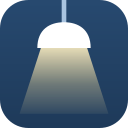
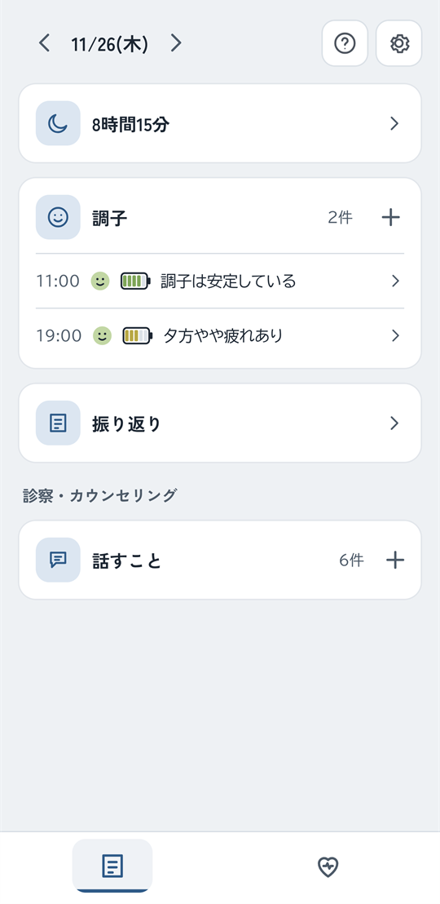
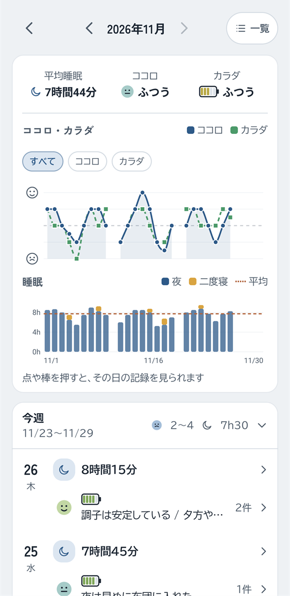
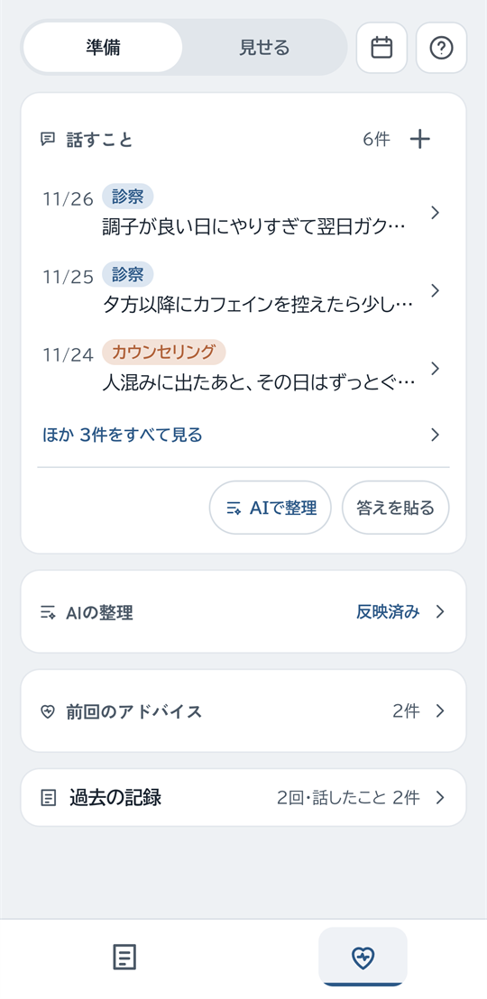
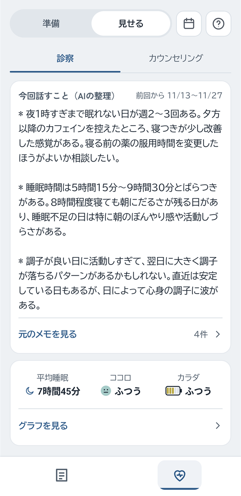

<div align="center">
  
  <h1>わたくしごと</h1>
  <p>
    精神科・心療内科の診察やカウンセリングに向けて、<br>
    毎日の睡眠・調子の記録と「話したいこと」を 1 画面にまとめる Android アプリです。
  </p>
  <p>
    <a href="https://github.com/likeUd0n/watakush1goto/releases"></a>
    
    
    <a href="LICENSE"></a>
  </p>
</div>

## スクリーンショット

| 記録 | 振り返り | 準備（話すこと） | 見せる（診察） |
| :---: | :---: | :---: | :---: |
|  |  |  |  |

## 主な特徴

- **完全オフライン・端末内完結**：`INTERNET` 権限を持ちません。記録はすべて端末内（Room DB）にのみ保存されます。
- **通知なし・書ける日だけでよい設計**：リマインダーやストリーク表示を置かず、記録できない日の負担を減らします。
- **「見せる」1 画面**：前回診察からの推移グラフ（睡眠・ココロ・カラダ）と今回話すことの一覧を、そのまま先生に見せられる形にまとめます（カウンセリング向けは最近の出来事・気持ちと前回の振り返り）。
- **手持ちの AI アプリで整理（任意）**：記録と相談メモから整理用プロンプトを作成し、ChatGPT・Claude・Gemini など手持ちの AI アプリへ共有・コピーできます（AI を使う操作をしたときだけ、渡した先の AI サービスに送信されます）。
- **睡眠時刻の自動推定（任意）**：「使用状況へのアクセス」を許可すると、画面オフ履歴から就寝・起床時刻を自動推定します（オフのまま手動入力も可能）。
- **JSON バックアップ**：端末内の任意の場所へ書き出し・読み込み（重複防止つき）ができます。

## インストール

[GitHub Releases](https://github.com/likeUd0n/watakush1goto/releases) から最新の APK をダウンロードし、Android 端末（Android 8.0 以上）にインストールしてください。

## 動作環境・技術構成

- Android 8.0 以上（`minSdk = 26`）
- `applicationId`: `io.github.likeud0n.watakush1goto`
- Kotlin / Jetpack Compose / Room / Preferences DataStore

## ビルド方法

```bash
./gradlew assembleDebug
```

単体テスト：

```bash
./gradlew testDebugUnitTest
```

## ドキュメント

- [コンセプト](docs/design/concept.md)
- [MVP 仕様](docs/requirements/mvp.md)

## ライセンス

- アプリ本体：[MIT License](LICENSE)
- 同梱フォント（BIZ UDPGothic / Zen Kaku Gothic New）：[SIL Open Font License 1.1](app/src/main/assets/licenses/)
